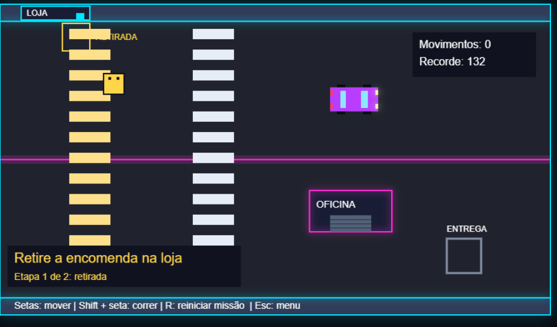

# 🌆 Cidade Neon

## 🎮 Jogue agora

👉 [Abrir Cidade Neon](https://jessicaofarias.github.io/jogo-urbano-js/)

Use um computador com teclado. Mova-se com as setas, corra com Shift + seta e reinicie com R.

Jogo 2D de entrega urbana desenvolvido com HTML, CSS e JavaScript, com gráficos desenhados usando a API Canvas.

O desafio é retirar uma encomenda no quadrado amarelo da loja e levá-la ao destino indicado em verde, desviando dos obstáculos e tentando concluir a missão com o menor número de movimentos.

> 🚧 Projeto em desenvolvimento, criado como parte do meu aprendizado em programação e desenvolvimento front-end.
>
> ## 📸 Prévia do jogo

## 🎮 Funcionalidades

- Tela inicial com apresentação do jogo, instruções e autoria.
- Botão Jogar para iniciar a partida.
- Movimento contínuo ao manter as setas do teclado pressionadas.
- Movimento diagonal com velocidade ajustada para evitar vantagem sobre o movimento em linha reta.
- Corrida usando Shift + seta.
- Limites de movimentação dentro do mapa.
- Colisões com a loja, o carro estacionado e a oficina.
- Missão em duas etapas: retirar a encomenda na loja e levá-la ao destino.
- Área amarela de retirada e destino que fica verde após coletar a encomenda.
- Retirada e entrega realizadas quando o personagem fica totalmente dentro da área correspondente.
- Encomenda desenhada no personagem durante o transporte.
- Mensagens indicando a etapa atual e a conclusão da missão.
- Contador de movimentos durante a missão.
- Registro do menor número de movimentos usando localStorage.
- Recorde da missão com retirada separado do recorde da versão anterior.
- Retorno ao menu com Esc, mantendo o progresso da partida atual.
- Botão Continuar para retomar a partida.
- Botão Nova partida e tecla R para reiniciar a missão sem apagar o recorde.
- Pausa automática quando a janela do jogo perde o foco.
- Navegação pelos botões com teclado e foco no canvas ao iniciar ou retomar.
- Cenário neon com loja, oficina, carro e faixas desenhados por código.

## ⌨️ Controles

| Tecla        | Ação                                |
| ------------ | ----------------------------------- |
| Setas        | Mover o personagem                  |
| Shift + seta | Correr                              |
| R            | Reiniciar a missão                  |
| Esc          | Voltar ao menu mantendo o progresso |

O contador aumenta a cada atualização da lógica em que o personagem se desloca, até concluir a entrega. Ele não representa a quantidade de teclas pressionadas.

Correr aumenta a distância percorrida por movimento.

O recorde corresponde ao menor número de movimentos usados para concluir a missão com retirada e entrega. Ele fica salvo no navegador utilizado, separado do recorde da versão anterior.

## 🛠️ Tecnologias

- **HTML5:** estrutura da página e elemento Canvas.
- **CSS3:** estilização da página.
- **JavaScript:** regras, interação e desenho do jogo.
- **Canvas 2D:** renderização do cenário e dos personagens.
- **localStorage:** armazenamento local do recorde.
- **Git e GitHub:** controle de versão e hospedagem do código.

## 🚀 Como executar

1. Baixe o projeto pelo botão **Code → Download ZIP**.
2. Extraia a pasta.
3. Abra o arquivo `index.html` em um navegador.
4. Use o teclado para jogar.

Também é possível abrir a pasta no VS Code e executar o projeto com a extensão Live Server.

## 📁 Estrutura do projeto

- `index.html` — estrutura da página.
- `style.css` — estilos da interface.
- `game.js` — desenho do cenário, controles e regras.
- `README.md` — documentação do projeto.

## 📚 Aprendizados praticados

Durante o desenvolvimento, pratiquei:

- Variáveis, constantes e funções.
- Condicionais e laços de repetição.
- Eventos de teclado.
- Coordenadas e desenho no Canvas.
- Detecção de colisão entre retângulos.
- Controle de estado da missão.
- Persistência de dados no navegador.
- Versionamento com Git e envio de alterações ao GitHub.

## 🔜 Próximas melhorias

- [x] Publicar uma versão jogável online.
- [x] Adicionar uma captura de tela ao README.
- [x] Criar uma tela inicial.
- [ ] Melhorar a adaptação da interface a diferentes telas.
- [ ] Organizar o código para facilitar a manutenção.
- [ ] Expandir o mapa e adicionar novas missões.

## 👩‍💻 Autora

Desenvolvido por **Jessica Farias** como projeto de estudo e evolução em desenvolvimento front-end.

[Meu GitHub](https://github.com/JessicaOFarias)
