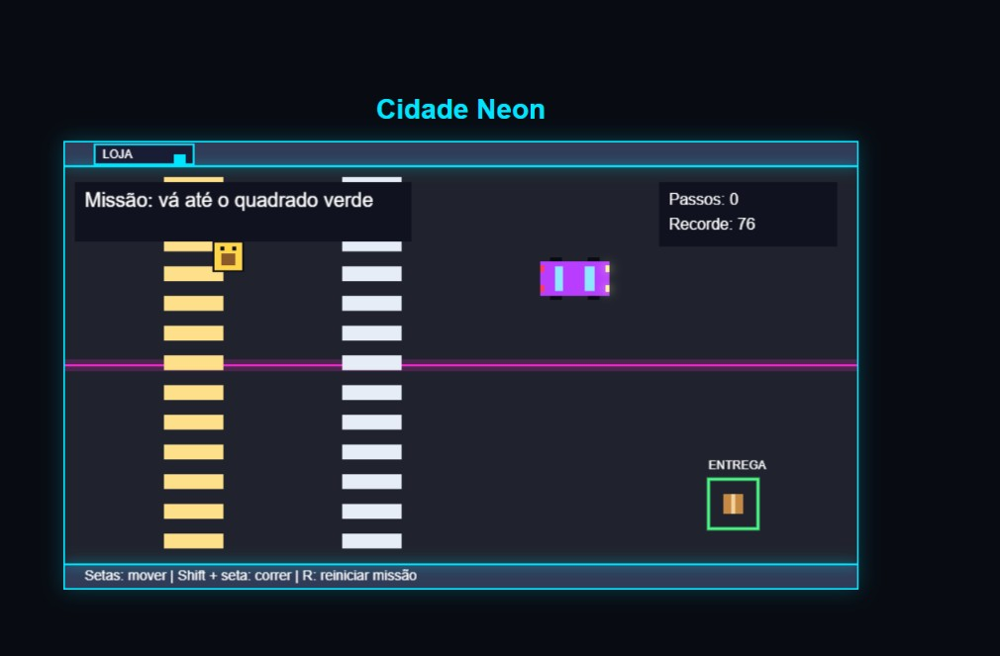

# 🌆 Cidade Neon

## 🎮 Jogue agora

👉 [Abrir Cidade Neon](https://jessicaofarias.github.io/jogo-urbano-js/)

Use um computador com teclado. Mova-se com as setas, corra com Shift + seta e reinicie com R.

Jogo 2D de entrega urbana desenvolvido com HTML, CSS e JavaScript, com gráficos desenhados usando a API Canvas.

O desafio é chegar ao destino indicado em verde, desviando dos obstáculos e tentando concluir a entrega com o menor número de passos.

> 🚧 Projeto em desenvolvimento, criado como parte do meu aprendizado em programação e desenvolvimento front-end.
>
> ## 📸 Prévia do jogo

## 🎮 Funcionalidades

- Movimentação do personagem pelas setas do teclado.
- Corrida usando Shift + seta.
- Limites de movimentação dentro do mapa.
- Colisão com a loja e o carro estacionado.
- Missão concluída quando o personagem fica totalmente dentro da área de entrega.
- Contador de passos durante a missão.
- Registro da melhor pontuação usando localStorage.
- Reinício da missão sem apagar o recorde.
- Cenário com cores neon e elementos desenhados por código.

## ⌨️ Controles

| Tecla        | Ação               |
| ------------ | ------------------ |
| Setas        | Mover o personagem |
| Shift + seta | Correr             |
| R            | Reiniciar a missão |

Cada movimento válido antes de concluir a entrega conta como um passo.
Correr aumenta a distância percorrida por movimento.

O recorde corresponde ao menor número de passos usados para concluir uma entrega e fica salvo no navegador utilizado.

## 🛠️ Tecnologias

- **HTML5:** estrutura da página e elemento Canvas.
- **CSS3:** estilização da página.
- **JavaScript:** regras, interação e desenho do jogo.
- **Canvas 2D:** renderização do cenário e dos personagens.
- **localStorage:** armazenamento local do recorde.
- **Git e GitHub:** controle de versão e hospedagem do código.

## 🚀 Como executar

1. Baixe o projeto pelo botão **Code → Download ZIP**.
2. Extraia a pasta.
3. Abra o arquivo `index.html` em um navegador.
4. Use o teclado para jogar.

Também é possível abrir a pasta no VS Code e executar o projeto com a extensão Live Server.

## 📁 Estrutura do projeto

- `index.html` — estrutura da página.
- `style.css` — estilos da interface.
- `game.js` — desenho do cenário, controles e regras.
- `README.md` — documentação do projeto.

## 📚 Aprendizados praticados

Durante o desenvolvimento, pratiquei:

- Variáveis, constantes e funções.
- Condicionais e laços de repetição.
- Eventos de teclado.
- Coordenadas e desenho no Canvas.
- Detecção de colisão entre retângulos.
- Controle de estado da missão.
- Persistência de dados no navegador.
- Versionamento com Git e envio de alterações ao GitHub.

## 🔜 Próximas melhorias

- [x] Publicar uma versão jogável online.
- [ ] Adicionar uma captura de tela ao README.
- [ ] Criar uma tela inicial.
- [ ] Melhorar a adaptação da interface a diferentes telas.
- [ ] Organizar o código para facilitar a manutenção.
- [ ] Expandir o mapa e adicionar novas missões.

## 👩‍💻 Autora

Desenvolvido por **Jessica Farias** como projeto de estudo e evolução em desenvolvimento front-end.

[Meu GitHub](https://github.com/JessicaOFarias)
